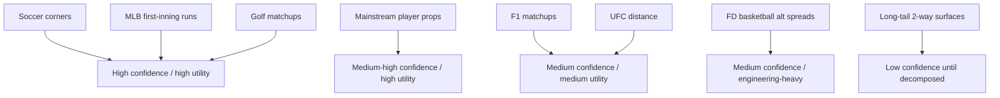
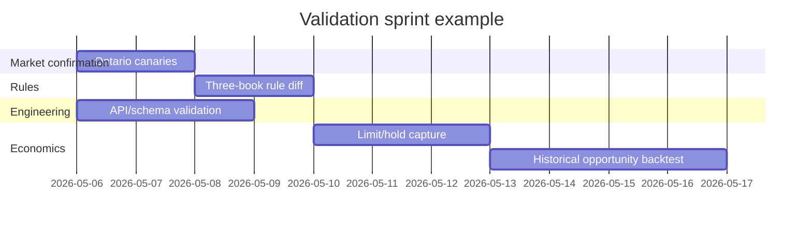

# Deep Research Review of the Uploaded Sports-Arbitrage Research Brief

## Executive summary

The uploaded PDF is a 22-page research brief about a production sports-arbitrage stack using entity["company","DraftKings","sportsbook company"] and entity["company","FanDuel","sports betting company"] for execution in entity["state","Ontario","province, canada"], with entity["company","Pinnacle","sportsbook company"] as a reference and potential hedge venue. It is not itself a finished research output; it is a scoped research agenda covering eight target market “surfaces” and a final prioritization formula. The document’s strongest feature is breadth and operational specificity. Its weakest feature is that many of its most important ranking inputs are assumptions rather than validated facts: Ontario-specific market parity, API coverage, stake limits, and realized profitability are mostly asserted as research questions rather than evidenced findings. fileciteturn0file0

The highest-confidence external findings are these. First, proper Ontario market access for DraftKings, FanDuel, and Pinnacle is real and regulated: DraftKings and FanDuel both maintain Ontario-facing sportsbook pages, Pinnacle has Ontario-specific terms restricting service to people physically in Ontario, and entity["organization","iGaming Ontario","ontario gaming authority"]’s regulated-market directory lists Pinnacle as an authorized regulated sportsbook/casino site. That materially changes the analytical framing: Pinnacle is not merely a conceptual sharp comparator in Ontario; it is also a regulated operator whose market presence can be part of the viability analysis. citeturn21view4turn21view5turn21view1turn21view2turn20search7

Second, the document’s proposed priority set is directionally sound, but the best-supported near-term surfaces are not identical in evidence quality. The clearest externally validated candidates are MLB first-inning markets, soccer corners/cards/player props, golf matchups, Formula 1 matchups/top-finish markets, and mainstream player props. Those surfaces have strong public evidence of market existence on operator pages and reasonably explicit settlement rules on at least one or two official books. By contrast, UFC “goes distance” is promising but still needs a full three-book rule-diff; FanDuel basketball alternate spreads are clearly real, but FanDuel’s own betting guide says alternate lines are mostly added to parlays and not normally bet straight, which weakens the file’s implied assumption that reuse from ordinary spread infrastructure will be frictionless; and the “lower-priority 2-way surfaces” bucket remains too heterogeneous to rank without much finer segmentation. citeturn24search8turn24search20turn3view4turn11view1turn11view4turn11view5turn9view0turn12view2turn15view0turn27search4turn28search6turn25search16turn25search19

Third, the document’s most important methodological correction is to split every surface into four distinct questions: “does the market exist,” “does it exist in Ontario on this book,” “is it accessible and normalizable through the current automation path,” and “is the available limit/latency/hold profile large enough to matter.” The PDF often treats those as a single decision, but they are separate gates and should be scored separately. Without that separation, the final prioritization formula will over-rank markets that look attractive conceptually but are operationally thin. fileciteturn0file0

## File analysis and core uncertainties

The file appears to be a Word-exported PDF created and modified on May 5, 2026, with a Microsoft Word for Microsoft 365 producer string and no machine-detectable embedded raster images. The visible structure is primarily continuous text with numbered sections and bullet lists; any “tables” are functionally text tables or structured bullet blocks rather than native embedded spreadsheet/table objects. That matters because the document is really a specification memo, not an evidence dossier. fileciteturn0file0

At a structural level, the brief has three layers. The opening layer defines the production context, the books in scope, and the instruction not to reduce the project to NRFI/YRFI only. The middle layer contains eight numbered research surfaces, each framed as a set of market-existence, edge-case, liquidity, and infrastructure questions. The last layer proposes a unified prioritization formula based on expected dollars per week, confidence, infra reuse, and development hours. Because the accessible text layer available in this session did not expose stable paragraph IDs or line-by-line page anchors for the uploaded PDF, the location references below are section-accurate but page/paragraph precision is approximate outside the opening mandate. That uncertainty should be treated as a file-format limitation, not as a substantive gap in the brief’s content. fileciteturn0file0

The largest unresolved uncertainties inside the file are not domain-theory questions; they are implementation questions. The PDF repeatedly asks for exact API path evidence, event-group mapping, market-key normalization, historical odds frequency, stake caps, correlation behavior, and “how often sigma falls below 1.0.” None of those are answered by the file itself. They require either authenticated book access, archived odds captures, or internal telemetry. As a result, any prioritization that pretends those questions are already closed would be overstated. fileciteturn0file0

## Topic-by-topic validation

The location tags below are best-effort section references from the uploaded file. Because the PDF’s available text layer did not expose stable line-mapped anchors here, I am tying each summary to the exact section topic and its relative place in the document rather than claiming paragraph-perfect pagination. fileciteturn0file0

**MLB first-inning runs and NRFI/YRFI**  
**File location:** opening research surfaces, first numbered baseball surface, early in the document. The brief asks whether DK, FD, and Pinnacle all offer first-inning run/no-run markets, whether the market is operationally arbable in Ontario, how to normalize settlement edge cases, and how often combined pricing creates a sub-1.0 opportunity. fileciteturn0file0  
**Verification:** FanDuel’s own research pages explicitly say NRFI odds appear as “1st Inning 0.5 Runs” under the Innings tab, and FanDuel Ontario house rules say inning/half-inning markets stand once the inning is completed unless the result was already unequivocally determined. DraftKings public pages and event pages show “Runs - 1st Inning” and “No Runs 1st Inning” markets. Pinnacle’s recovered public rules did not surface an NRFI label directly, but Pinnacle clearly supports baseball period markets and broad baseball player/period props, and its baseball rules are detailed enough to support continued validation work. MLB’s official scoring-changes page confirms postgame scoring corrections exist, which can affect some derivative markets and player props. citeturn3view4turn10view0turn10view6turn24search8turn24search20turn15view2turn17view0turn22search2  
**Gaps, inconsistencies, assumptions:** the file assumes Ontario parity for every retrieved U.S.-facing market page; public pages strongly suggest availability, but Ontario-specific parity still needs direct canary confirmation. The file also treats pricing frequency, hold, and limits as if they are likely retrievable externally; in practice those are not publicly provable from recovered official sources. fileciteturn0file0  
**Recommended correction:** rewrite the surface as “MLB first-inning total-runs/NRFI-YRFI, conditional on Ontario canaries confirming simultaneous DK/FD/Pinnacle coverage, independent inning settlement, and minimum executable stake.” Add a separate rule sheet for suspended games, listed-pitcher changes, and whether pregame vs live treatment differs by operator. citeturn10view5turn10view6turn15view2

**UFC distance markets**  
**File location:** second numbered early-document surface on fight-distance markets, including stoppage, doctor stoppage, DQ, no-contest, and cancellation edge cases. fileciteturn0file0  
**Verification:** FanDuel Ontario rules state that “Will the fight go the distance?” is settled on whether all scheduled rounds are completed, and if a technical decision is declared after a stoppage before the end of the last scheduled round, “No” wins. DraftKings search-result snippets for its official MMA and boxing rules say “Yes” wins only if the full number of officially scheduled rounds are completed. That is strong support for the file’s intuition that this market is settlement-sensitive and potentially cross-book-divergent in edge cases. citeturn8view0turn23search1turn23search5  
**Gaps, inconsistencies, assumptions:** I did not recover a comparable Pinnacle fight-distance rule passage in the retrieved official sources, so the three-book settlement-comparison work the file asks for is not complete. That means the document is correct to highlight edge-case risk, but premature if it tries to rank this surface ahead of better-documented markets.  
**Recommended correction:** keep UFC distance in the top research tier but not the top implementation tier until there is a full three-book rule-diff table covering technical decision, doctor stoppage between rounds, doctor stoppage mid-round, DQ, no-contest, and cancellation. Treat this surface as “high upside, medium documentation risk.” fileciteturn0file0

**Soccer corners, cards, and player props**  
**File location:** middle early/mid-document soccer surface focusing on corners, card markets, Both Teams To Score combinations, and player-stat props. fileciteturn0file0  
**Verification:** This is one of the strongest validated sections in the whole brief. FanDuel Ontario rules define corners as corners *taken*, not awarded; corner retakes count once; card-index/booking-point treatment is explicit; and many player props are settled off official entity["company","Opta","sports data provider"] data. Pinnacle’s soccer rules also define booking and corner treatment explicitly: yellow cards count as one booking, red cards as two, second yellows are ignored for additional booking count, corner retakes count once, and awarded-but-untaken corners do not count. DraftKings official event pages visibly expose corners and player-prop categories on live soccer pages. citeturn11view1turn11view4turn11view5turn8view7turn15view1turn29search6turn29search10turn29search37  
**Gaps, inconsistencies, assumptions:** the file is right to suspect structured opportunity here, but it underestimates rule heterogeneity. FanDuel’s booking-points representation and Pinnacle’s booking-count representation are not the same object and cannot be normalized by a naive “cards total” mapper.  
**Recommended correction:** split this surface into two sub-surfaces in the prioritization model: “soccer corners” and “soccer cards/player optics.” Corners should rank very highly because both settlement definitions are explicit and comparable. Cards and player props should carry a slightly lower confidence score because stat-source and scoring-unit differences create hidden normalization risk. citeturn11view1turn11view4turn15view1

**Golf matchups and finishing-position markets**  
**File location:** mid-document golf surface concerned with head-to-head and tournament placement style markets. fileciteturn0file0  
**Verification:** FanDuel Ontario house rules are detailed on golf: tournament bets require 36 holes for action, 2/3-ball and tournament match betting rules are explicit, and make/miss-cut and tie handling are specified. Pinnacle’s golf rules are similarly explicit on reduced-hole tournaments, matchups, cut handling, handicaps, and top-finish treatment. FanDuel and Pinnacle both publicly show golf matchup and finishing-position market pages. The file’s intuition that golf is operationally appealing because settlement logic is structured and events are slower-moving is well supported. citeturn12view2turn12view4turn12view5turn15view0turn26search15turn26search22turn18search1turn18search3  
**Gaps, inconsistencies, assumptions:** DraftKings sport-rule text was not recoverable in a useful way from retrieved official pages, so a full three-book rules matrix is incomplete. The file also seems to treat “golf” as a single family, but round matchups, tournament matchups, group betting, and finishing positions have different tie and withdrawal dynamics.  
**Recommended correction:** keep golf high priority, but split it into “round/2-ball/3-ball matchup markets” and “tournament/top-finish/group markets.” The first bucket should rank above the second because settlement is more local, quicker, and easier to backtest cleanly. citeturn12view0turn12view4turn15view0

**Formula 1 and broader motorsport matchups**  
**File location:** mid-to-late document motorsport/F1 surface covering driver matchups, race props, and top-finish style markets. fileciteturn0file0  
**Verification:** Market existence is clearly supported. FanDuel has dedicated motorsport and Formula 1 odds pages and current research pages referring users to the full F1 betting menu. DraftKings has dedicated Formula 1 league pages and a Formula 1 driver-props “matchups” subcategory. Pinnacle has Formula 1 matchups and Formula 1 league pages. This is enough to confirm that the surface is real across the target ecosystem. citeturn27search4turn27search7turn27search12turn28search0turn28search6turn18search0turn18search3turn18search6  
**Gaps, inconsistencies, assumptions:** the file’s biggest weakness here is settlement ambiguity. I did not recover a clean official three-book ruleset for DNF handling, classified finishers, sprint vs race treatment, or pole/qualifying derivatives. So the surface is market-available but not yet rules-closed.  
**Recommended correction:** reclassify F1 as “availability confirmed, settlement diff incomplete.” It should remain in the near-term research set, but below golf and soccer until the classification/DNF/tie mechanics are normalized. fileciteturn0file0

**FanDuel basketball alternate spreads**  
**File location:** later document engineering-heavy surface about alternate spreads on FanDuel basketball, infra reuse, and observed stake capacity. fileciteturn0file0  
**Verification:** FanDuel’s official betting guide explicitly says alternate lines let bettors choose their own spread or total, but also says the majority of alternate spreads and totals are added to parlays and not normally bet as a straight wager. FanDuel’s NBA pages and research pages confirm broad NBA menu depth and player-prop depth. That means the market family exists, but the file’s implied assumption that alt spreads behave like ordinary spread markets for placement purposes is only partially supported. citeturn25search16turn25search19turn25search8turn25search21  
**Gaps, inconsistencies, assumptions:** the PDF’s internal statements about an existing beta path, code reuse, and roughly $6,000 of observed actual stake are not independently verifiable from the file alone. The official evidence actually cuts both ways: existence is confirmed, but UI/SGP bias may make straight-bet extraction and automation more fragile than the brief implies.  
**Recommended correction:** downgrade this from “easy infra reuse” to “engineering candidate requiring UI/API survivability testing.” Score it as high infra familiarity but medium execution certainty. fileciteturn0file0

**Lower-priority two-way surfaces**  
**File location:** later document catch-all section for additional two-way surfaces beyond the core list. fileciteturn0file0  
**Verification:** Public operator evidence confirms that these books are broad enough to support many such surfaces. DraftKings has tennis odds and explicit “Aces & Breaks” categories; FanDuel has tennis, esports, and broad niche-sport navigation; Pinnacle’s “bets offered” page includes tennis game-level, player-prop, and specialized categories. citeturn29search0turn29search4turn29search8turn27search20turn26search3turn27search8turn17view0  
**Gaps, inconsistencies, assumptions:** this section is too broad to be prioritized credibly as a single surface. Tennis service-game props, esports map props, and miscellaneous two-way markets have very different latency, data-source, and settlement characteristics.  
**Recommended correction:** replace the bucket with explicit subfamilies. If tennis is included, split “match winner / set winner” from “aces/breaks/game-level props.” If esports is included, split by title and map architecture. Do not score “lower-priority two-way surfaces” as one line item. fileciteturn0file0

**Cross-league player props**  
**File location:** late-document player-prop surface covering major North American leagues and related stat categories. fileciteturn0file0  
**Verification:** FanDuel Ontario house rules explicitly cover daily and playoff props and, for some soccer stat categories, state the official data source. Pinnacle’s official “bets offered” page lists a wide range of player-prop categories including assists, points, PRA, shots on goal, strikeouts, total bases, and more. MLB’s official scoring-changes page confirms postgame stat changes occur. This is enough to confirm that player props are deep and commercially important, but also that they carry official-data and correction-window complexity. citeturn8view6turn11view5turn12view7turn17view0turn15view2turn22search2  
**Gaps, inconsistencies, assumptions:** the file does not yet separate “book offers the prop” from “book exposes a stable stat source and correction policy that harmonizes across books.” That is the main hidden risk.  
**Recommended correction:** keep player props in the roadmap, but require a per-league settlement-source matrix before implementation. At minimum, every prop family should record governing source, correction window, starter requirement, void condition, and overtime/extratime treatment. fileciteturn0file0

## Claims versus authoritative sources

| File claim or working assumption | What authoritative sources show | Assessment | Recommended correction |
|---|---|---|---|
| DK and FD are active Ontario placement books. fileciteturn0file0 | DraftKings and FanDuel both maintain Ontario-facing sportsbook/casino pages. citeturn21view4turn21view5 | **Confirmed** | Keep as a stated operational fact. |
| Pinnacle is only a reference/hedge book in the Ontario context. fileciteturn0file0 | Pinnacle has Ontario-specific terms requiring players to be physically in Ontario, and iGaming Ontario lists Pinnacle in its regulated-market directory. citeturn21view1turn21view2turn20search7 | **Operationally incomplete** | Rewrite as “not currently used for placement by the system, but regulated and available in Ontario.” |
| NRFI/YRFI is a plausible top-priority market family. fileciteturn0file0 | FanDuel explicitly exposes “1st Inning 0.5 Runs” NRFI-style markets; DraftKings shows first-inning runs and no-runs-first-inning pages. citeturn3view4turn24search8turn24search20 | **Confirmed on market existence** | Keep high priority, but only after Ontario/API/limit gates are tested separately. |
| Soccer corners/cards/player props can be normalized cleanly. fileciteturn0file0 | FanDuel and Pinnacle both publish explicit rules, but booking and cards are not normalized identically across books, while corners are much closer. citeturn11view1turn11view4turn15view1 | **Partially confirmed** | Split corners from cards/player-stat markets in the roadmap. |
| Golf and F1 matchup markets are good adjacent surfaces. fileciteturn0file0 | Market existence is strongly supported across books, and golf rules are especially mature; F1 availability is strong but full settlement harmonization is still incomplete in recovered sources. citeturn12view2turn15view0turn27search4turn28search6turn18search6 | **Golf stronger than F1** | Rank golf above F1 until F1 classification/DNF rules are fully normalized. |
| FanDuel basketball alternate spreads should be straightforward because of infra reuse. fileciteturn0file0 | FanDuel says alternate lines exist, but also says they are mostly added to parlays and not normally bet straight. citeturn25search16turn25search19 | **Needs caution** | Treat as an engineering-validation project, not a near-certain quick win. |
| Cross-league player props are a broad scalable category. fileciteturn0file0 | FanDuel and Pinnacle both offer extensive prop menus, but official-data and scoring-correction complexity is real. citeturn8view6turn11view5turn17view0turn22search2 | **Confirmed with caveats** | Add a per-league data-source and correction-window matrix before ranking by EV. |
| Internal API coverage, observed stakes, hold, and sigma frequency can be resolved from public research alone. fileciteturn0file0 | No recovered official public sources provided the necessary authenticated API-field mapping, historical max stake telemetry, or realized sub-1.0 frequency. | **Unsupported** | Move these inputs into a dedicated internal validation workstream; do not let them hide inside “confidence.” |

## Prioritized follow-up research tasks

The PDF is strongest as a roadmap when converted into a staged validation program. The sequence below is the most defensible order given the evidence now in hand.

| Priority | Task | Why it matters | Estimated effort | Resources |
|---|---|---|---|---|
| High | Ontario canary matrix for all eight surfaces across DK, FD, Pinnacle | Separates “publicly visible somewhere” from “actually live and tradable in Ontario now” | 1–2 working days | 1 analyst + 1 sportsbook QA/operator user |
| High | Three-book settlement-rule diff table | Reduces silent arb-break risk on fight, soccer, golf, F1, and player props | 6–10 hours | 1 research analyst |
| High | API/schema survivability test for target market families | Converts conceptual opportunity into automation feasibility | 2–3 working days | 1 engineer + sample auth access |
| High | Limit and hold capture on live markets | Prevents false prioritization of low-capacity markets | 2–4 working days | 1 analyst + small monitored bankroll / read-only account access |
| Medium | Historical odds archive and sub-1.0 frequency backtest | Validates whether theoretical opportunity occurs often enough to matter | 3–5 working days | 1 quant + 1 data engineer |
| Medium | Player-prop stat-source and correction-window matrix by league | Critical for MLB/NBA/NHL/NFL derivative settlement safety | 1–2 working days | 1 analyst |
| Medium | Re-score the surface roadmap using separated gates | Produces a credible production order instead of a concept rank | 4–6 hours | 1 analyst or quant |
| Lower | Engineering spike on FanDuel alt spreads | Valuable only after confirming alt-line extraction path and straight-bet executability | 1–2 working days | 1 engineer |

A practical production ordering, based on current evidence quality rather than speculative upside, is: **soccer corners**, **MLB first-inning runs/NRFI-YRFI**, **golf matchups**, **mainstream player props**, **F1 matchups**, **UFC distance**, **FanDuel basketball alt spreads**, and then the decomposed long-tail two-way surfaces. The reason is simple: the first four have the best mix of public rule clarity, visible market existence, and manageable normalization scope. citeturn11view1turn3view4turn24search8turn12view2turn15view0turn17view0turn8view6

## Suggested visualizations

The evidence supports a visualization strategy focused on gating, not just ranking. The strongest communication device here is a “four-gate” funnel: market existence, Ontario availability, API addressability, and executable economics. That makes the file’s hidden assumptions visible to both engineering and trading stakeholders. fileciteturn0file0

A second useful chart is a production-priority map that separates confidence from upside, instead of combining everything into a single opaque priority score.

A third good deliverable is a short gantt-style implementation plan for the next validation sprint.

## Open questions and limitations

This review is strongest where official operator pages and official rules were recoverable. It is weaker where public official pages were present but poorly machine-readable. The biggest example is DraftKings sport-rule detail: some DraftKings pages were visible, but multiple sport-rule pages did not expose full rule text cleanly in retrieved page bodies, so DraftKings-specific settlement detail is less complete than FanDuel and Pinnacle in this report. citeturn23search1turn23search3turn23search0

The uploaded PDF’s internal claims about current engineering capability, live authenticated API access, observed stake sizes, and infra reuse could not be independently audited from the file alone. Those may be entirely correct, but they should be treated as internal working assumptions until matched against repo evidence, telemetry, or production logs. fileciteturn0file0

The file also asks for exact historical opportunity rates, hold distributions, and limit behavior. Those are not realistically answerable from public official sources alone. They require direct capture from the books or internal historical data. That is not a flaw in the brief; it is an important distinction between market research and deployability research. fileciteturn0file0

The central correction, therefore, is not to reduce scope. It is to make scope explicit. The brief should become a two-stage document: **market validation** first, **production prioritization** second. Right now it blends the two. Once those are separated, the roadmap becomes materially clearer and much more defensible. fileciteturn0file0turn0file0